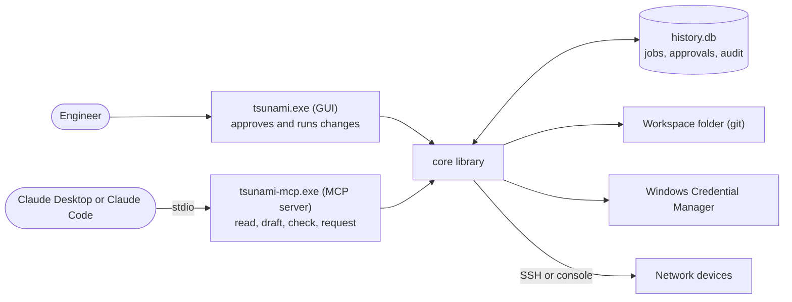

# Tsunami design

## Overview

Tsunami is a Windows-native desktop tool that pushes templated Cisco IOS/IOS-XE and HPE Aruba AOS-CX/AOS-S configuration to up to 200 devices over SSH or console. It has a GUI for people and a local MCP server for Claude.

This document is the build spec. It is written to be handed to Claude Code as the source of truth; where it says "must", treat it as a requirement.

### Goals

- Run plays from a GUI: pick a play, pick targets, fill prompts, preview, push.
- Three play types on one engine: initial (day-0), push (ad-hoc change), baseline (per-customer standard config).
- Layered variables (global, role, customer, site, device, play, prompt) with typed, validated prompts.
- Safe fleet pushes: render preview, diff against running config, batches with max-fail, canary device, pre/post checks, automatic rollback.
- Drift reporting: compare running config to a customer baseline without pushing.
- An MCP interface that lets Claude read inventory, write draft plays, render, and run read-only checks without ever receiving credentials or secret values. Changes to customer devices require human approval in the GUI.

### Hard constraints

- Runs natively on Windows 10 and 11. No WSL, Docker, Linux VM, or separately installed Python.
- Installs per-user from a single installer with no admin rights.
- Secret values live only in Windows Credential Manager. Never in YAML, git, logs, the job database, or MCP output.
- Scale ceiling: 200 devices per run.
- Platforms in v1: Cisco IOS and IOS-XE, HPE Aruba AOS-CX, and HPE Aruba AOS-S (ArubaOS-Switch, formerly ProCurve). Everything platform-specific lives in platform drivers (see Platform drivers), so more platforms can be added later.

### Non-goals for v1

- Idempotent resource modules in the Ansible sense. Pushes are rendered CLI. Re-applying a baseline adds lines but never removes them.
- NETCONF, RESTCONF, or YANG.
- Multi-user server, web UI, or a remote MCP endpoint.
- Git operations inside the app. The workspace is a git repo managed with VS Code or Git for Windows.
- Linux or macOS builds.

## Architecture

One core library does all the work. Two front ends sit on top of it: a windowed GUI and a stdio MCP server. They share a SQLite database for jobs, approvals, and audit. The core must not import PySide6, so it can be unit-tested and driven headless.



Claude reaches devices only through the core and sees only redacted results. Its change requests wait in history.db until you approve them in the GUI.

### Components

- **core**: models, workspace loader, variable resolver, renderer, runner, transports, checks, rollback, redactor, secrets, history, policy.
- **GUI** (`tsunami.exe`, windowed): the only place a person approves and runs changes against customer devices.
- **MCP server** (`tsunami-mcp.exe`, console): launched by Claude Desktop or Claude Code over stdio. Runs read-only jobs itself. Writes change requests to the database as pending jobs. Runs apply jobs only for lab customers, and only when the policy allows it.
- **Dev CLI** (`python -m tsunami`): headless entry point for development and integration tests. Not shipped as its own exe in v1.

### Data locations

|   |   |   |   |
|---|---|---|---|
|Location|Path|Contents|In git|
|App|`%LOCALAPPDATA%\Programs\Tsunami`|Binaries|No|
|Workspace|User-chosen folder|Inventory, snippets, plays, drafts, generated schemas|Yes|
|Machine data|`%LOCALAPPDATA%\Tsunami`|`history.db`, backups, logs, per-customer `known_hosts`|No|
|Settings|`%APPDATA%\Tsunami`|`settings.json`, `mcp-policy.yml`|No|
|Secrets|Windows Credential Manager|Device logins, secret values|No|

Machine data stays out of the workspace because running configs contain password hashes, SNMP communities, and keys. MCP policy stays out of the workspace because Claude can write to the workspace (drafts only) and must never be able to edit its own permissions.

### Process model

- The GUI and MCP server are separate processes. The MCP server holds no credentials, opens no `history.db` and contacts no device: it relays each tool call over a local named pipe to the GUI, which runs the tools (enforcement, redaction, audit, and any job they start) and answers only while Tsunami is unlocked. Locked, the GUI answers `403 Tsunami is locked`; closed, the relay answers `503 Tsunami is not running`; the MCP server keeps running either way. The pipe has Windows' default named-pipe security (you, SYSTEM and administrators), and its handshake needs a random token the GUI writes to `%LOCALAPPDATA%\Tsunami` at each start. Messages are JSON.
- The GUI and the CLI open their own connections to `history.db` (WAL mode, `busy_timeout` 5000 ms).
- A run uses a `ThreadPoolExecutor` with one worker per device in the current batch. Hard cap: 50 concurrent sessions per run.
- In the GUI, the runner lives in a `QThread`. Workers report through Qt signals. UI updates are throttled to every 100 ms. Worker threads never touch widgets.
- Cancellation is cooperative through a `threading.Event`. In-flight devices finish their current step, then stop and roll back if a change was partly applied.
- Every running job updates `jobs.heartbeat_at` every 10 seconds. At startup and on every approvals poll, the GUI and the MCP server mark any `running` job whose heartbeat is older than 60 seconds as `interrupted`, and each of its unfinished devices as `interrupted`. This covers a process that dies mid-run, most likely the MCP server when its client closes, which leaves no chance to roll back. Interrupted devices are treated like `rollback_failed` in the job view. Lab plays run through MCP should prefer `rollback: revert_timer`, so IOS reverts on its own if the process dies.
- In apply mode, each device is leased in `device_leases` before connecting. A device already leased by another job with a live heartbeat fails with `device_busy` and is not touched. This stops the GUI and the MCP server from changing the same device at once. Leases are released at disconnect and lapse with the owning job's heartbeat.

## Technology stack

Python 3.12 with pure-Python or Windows-wheel dependencies covers everything, so nothing needs a POSIX layer. Paramiko does SSH in-process (no OpenSSH binary), pyserial drives COM ports, and keyring talks to Credential Manager.

|   |   |   |
|---|---|---|
|Package|Purpose|Notes|
|Python 3.12|Runtime|Bundled by PyInstaller. 3.13 is acceptable if every dependency ships wheels for it.|
|PySide6|GUI|LGPL. The onedir build keeps Qt as separate DLLs, which satisfies dynamic linking.|
|netmiko|SSH and serial sessions|Uses paramiko for SSH and pyserial for `cisco_ios_serial`.|
|pyserial|COM ports|`serial.tools.list_ports` populates the port picker.|
|jinja2|Templates|Use `jinja2.sandbox.ImmutableSandboxedEnvironment`.|
|pydantic v2|Models, validation, JSON Schema export|Single source of truth for every file format.|
|ruamel.yaml|YAML load and dump|Preserves comments and key order when the app writes YAML (add to inventory, draft promotion).|
|keyring|Credential Manager|Set the `WinVaultKeyring` backend explicitly (see Packaging).|
|mcp|MCP server|Official Python SDK 2.x (`MCPServer`, formerly FastMCP), stdio transport.|
|pyinstaller|Build|Onedir, two executables.|
|Inno Setup|Installer|Build-time only.|
|pytest, pytest-qt|Tests|Plus the MCP Inspector for manual MCP testing.|

### Rules

- Manage the environment with uv and commit the lockfile. Resolve current versions at build time; do not pin versions from memory.
- Before relying on a library parameter named in this spec, check it against the installed version and its docs. The Netmiko parameters this design depends on are `sock`, `config_mode_command`, `error_pattern`, `ssh_strict`, `alt_host_keys`, `alt_key_file`, and session-log masking.
- No Nornir. A custom inventory hierarchy plus batching and max-fail make it a poor fit, and it is one more thing to package.
- No TextFSM or ntc-templates in v1. Facts come from regex parsing of `show version`. Revisit if structured parsing of more commands is needed.

## Workspace layout

The workspace is a plain folder, normally a git repo, that the app points at. Everything people or Claude author lives here, and no secret value ever does.

```
<workspace>/
├─ workspace.yml
├─ inventory/
│  ├─ global.yml
│  ├─ roles/
│  │  ├─ access.yml
│  │  └─ distribution.yml
│  └─ customers/
│     └─ <customer>/
│        ├─ customer.yml
│        ├─ devices.yml
│        └─ sites/
│           └─ <site>.yml
├─ snippets/
│  ├─ common/<family>/
│  ├─ platform/<platform>/
│  └─ customers/<customer>/<family>/
├─ plays/
│  ├─ initial/
│  ├─ push/
│  └─ baseline/
├─ drafts/
│  ├─ plays/        (mirrors plays/)
│  └─ snippets/     (mirrors snippets/)
├─ .schema/          (generated, never hand-edited)
├─ .vscode/settings.json
└─ .gitignore
```

### Rules

- Slugs (customer folders, site files, role files, device names, snippet names) match `^[a-z0-9][a-z0-9-]*$`. Customer slugs appear in credential and secret names.
- YAML files use `.yml`. Snippets use `.j2`.
- `drafts/` is the only place the MCP server can write plays and snippets. A draft becomes live only when a person promotes it in the GUI, which moves it to the matching path under `plays/` or `snippets/`. The one exception is inventory additions (`add_customer`, `add_site`, `add_devices`), off unless the policy sets `inventory_edits: true`; they add and never edit or delete (see MCP interface: Tools).
- `workspace.yml` holds the workspace name, `schema_version`, default platform, and default batch size. It holds nothing that affects MCP permissions.
- The app refuses a workspace whose `schema_version` is newer than it understands, and offers a migration for older ones.

### Init workspace

The GUI (and the dev CLI) has an Init workspace action. It creates the skeleton above, writes `.gitignore`, generates JSON Schemas from the Pydantic models into `.schema/`, and writes `.vscode/settings.json` so the Red Hat YAML extension validates and autocompletes every file type:

```json
{
  "yaml.schemas": {
    "./.schema/play.schema.json": ["plays/**/*.yml", "drafts/plays/**/*.yml"],
    "./.schema/customer.schema.json": "inventory/customers/*/customer.yml",
    "./.schema/devices.schema.json": "inventory/customers/*/devices.yml",
    "./.schema/vars.schema.json": ["inventory/global.yml", "inventory/roles/*.yml", "inventory/customers/*/sites/*.yml"],
    "./.schema/workspace.schema.json": "workspace.yml"
  }
}
```

Schemas are regenerated on every app start if the app version changed. `.gitignore` excludes `*.cfg`, `*.log`, and `*.db` as a guard, even though the app never writes those into the workspace.

## Inventory and variables

Inventory is customers, then sites, then devices, with roles as a cross-cutting dimension. Variables merge in a fixed eight-level order, and there are no other merge rules.

### customer.yml

- `name`: display name. Required.
- `credential`: name of the login credential in Credential Manager. Required. The default login for the customer's devices.
- `jump_host`: optional object with `host`, `port` (default 22), and `credential`.
- `lab`: bool, default false. Marks a lab customer such as CML. MCP policy decides whether lab customers can be changed without approval.
- `vars`: customer-level variables.
- `role_vars`: map of role slug to variables, for customer-specific role defaults.
- `site_credentials`: optional map of site slug to login credential name: the default login for devices at that site.

### devices.yml

A list of devices. Each device has:

- `name`: unique within the customer. Also the default value of the `hostname` variable.
- `host`: IP or DNS name used to connect.
- `port`: default 22.
- `site`: must match a file in `sites/`.
- `role`: the device type. One of the built-in types `core`, `distribution`, `access` (switches), `wlc`, `ap` and `router`, or a custom role with a file in `inventory/roles/`. A file for a built-in type adds variables to it. Plays target types with `targets.roles`.
- `platform`: `ios`, `ios-xe`, `aos-cx`, or `aos-s`.
- `model`: optional hardware catalog id. Written by `add_to_inventory`; used for the facts sanity check.
- `credential`: optional login credential name for this device.
- `vars`: device-level variables.

A device logs in with its own `credential`, else its site's entry in `site_credentials`, else the customer's `credential`. Day-0 staging over console has no device yet and uses the customer's.

The GUI edits inventory through the Inventory view's context menus: devices (edit, delete, properties), sites (new device, edit, settings, delete), and customers (add site, properties, delete). Every edit keeps comments and layout, is validated before it is written, and is written atomically. Deleting a customer or a site file sends it to the Recycle Bin; deleting a site with devices needs explicit consent and removes them too.

Each platform belongs to a family that shares one CLI: `ios` and `ios-xe` are family `ios`, and `aos-cx` and `aos-s` are each their own family. Netmiko device types and console handling come from the platform driver (see Platform drivers).

### Hardware catalog

The app ships a catalog of common Cisco and Aruba switch families in `core/data/hardware.yml`. It lives in code, not the workspace. The day-0 wizard uses it so people pick a switch model from a dropdown instead of typing a platform.

- Each entry has `id` (slug), `vendor`, `label` (the dropdown label), `platform`, `netmiko_device_type`, `console_baud`, `lifecycle` (`current` or `end-of-sale`), `eos_year`, `model_pattern` (a regex searched in the model string that fact gathering reports), and `examples` (representative SKUs).
- An entry is selectable only if its platform has a driver. Every catalog platform has one in v1; the rule covers platforms added to the catalog before their driver exists, which appear disabled and labeled "not supported yet".
- The `model` prompt type picks an entry. In an initial play it sets the built-in `platform`, and the serial `baud` unless the play sets `connection.baud`. The dropdown offers only models whose platform has every snippet the play uses; if no model qualifies, the play fails validation.
- An entry can span product lines that reached end of sale in different years; `eos_year` is the year the newest of them did.
- When facts are gathered for a device with a `model`, a reported model that does not match the entry's `model_pattern` is a warning, not a failure. The platform check in the device pipeline still applies.

### Precedence, lowest to highest

1. `inventory/global.yml`
2. `inventory/roles/<role>.yml`
3. `customer.yml` `vars`
4. `customer.yml` `role_vars.<role>`
5. `sites/<site>.yml`
6. Device `vars`
7. Play `vars`
8. Runtime prompt values

### Merge rules

- Dicts deep-merge. Lists and scalars replace. A customer `ntp_servers` list replaces the global one entirely; it does not append.
- `null` is an ordinary value. There is no delete or unset syntax.
- Variable names match `^[a-z][a-z0-9_]*$`.
- Built-in variables are set by the engine and cannot be defined in any vars file: `inventory_name`, `customer`, `site`, `role`, `platform`, `host`, and `facts` (populated after fact gathering). Defining one is a validation error. Initial plays are the one exception (see Cross-field validation).
- Vars files never contain secret values. The linter warns on any key containing `password`, `secret`, `key`, `community`, or `psk` that has a literal string value.

### Provenance

The resolver returns every value together with the level and file it came from, including nested dict keys. The GUI shows this in the device view, and the MCP `resolved_vars` tool returns it. Ansible shows merged values but not where they came from; this is the main debugging aid for layered variables.

## Play schema

A play is one YAML file that declares its type, customer, connection, targets, prompts, steps, execution options, and checks. The type only sets defaults; every type runs through the same engine.

### Example

```yaml
name: Acme access switch (day 0)
description: Bench-stage a new access switch
type: initial
customer: acme
connection:
  method: serial
  port: ask
prompts:
  model:
    type: model
    label: Switch model
  hostname:
    type: hostname
  site:
    type: site
  mgmt_vlan:
    type: vlan
  mgmt_ip:
    type: ipv4_interface
    label: Mgmt SVI (IP/prefix)
  gateway:
    type: ipv4
  uplink:
    type: interface
    default: TenGigabitEthernet1/1/1
vars:
  role: access
steps:
  - snippet: base
  - snippet: aaa
  - snippet: ntp
    tags: [ntp]
  - config:
      - spanning-tree mode rapid-pvst
  - snippet: access-ports
    when: platform == "ios-xe"
execution:
  save: true
checks:
  post:
    - exec: show interfaces {{ uplink }} status
      expect: connected
on_success:
  add_to_inventory: true
```

### Top-level fields

- `name`: string. Required.
- `description`: string. Optional.
- `type`: `initial`, `push`, or `baseline`. Required.
- `customer`: customer slug. Required for every type. One run touches exactly one customer and one credential set.
- `customer: global` makes a global play: a generic play that runs for any customer. It is bound to the customer chosen at run time (the GUI asks; MCP tools take a `customer` argument), and the job belongs to that customer. Its secrets are written `secret('name')`, which resolves to the bound customer's secret, so one customer's secret never reaches another's run. At load it is checked for schema and target roles only; targets, snippets and renders are checked against the customer when it runs. `global` is reserved: no customer folder may use it. A play becomes global through Copy… in the Plays view (Global is listed first): the copy gets `customer: global`, its `secret('customer/name')` references become `secret('name')`, and a play that names devices in `targets.devices` is refused, since a global play picks devices by role or site.
- In any play, `secret('name')` means the play's own customer, the same as `secret('<customer>/name')`.
- A play can be copied to another customer (GUI: Copy to customer). The copy is a new file beside the original with `customer` changed and `secret('<old>/name')` rewritten to `secret('name')`; snippets are not copied.
- `connection`: see below.
- `targets`: see below.
- `prompts`: map of variable name to prompt definition.
- `vars`: fixed play variables (precedence level 7).
- `steps`: list of steps. At least one.
- `execution`: see below.
- `checks`: `pre` and `post` lists.
- `on_success`: `add_to_inventory` (initial plays only).

### connection

- `method`: `ssh`, `serial`, or `render`. Default comes from the type.
- `port`: serial only. `COMn` or `ask`. Default `ask`, which shows a picker filled from `serial.tools.list_ports`.
- `baud`: serial only. Default 9600.

### targets

- Keys: `sites`, `roles`, `devices`, `exclude`. Each is a list of slugs.
- Different keys combine with AND. Items within one list combine with OR. `exclude` is applied last.
- Required for `push` and `baseline`, and must resolve to at least one device. An empty `targets` is a validation error, never "all devices".
- Forbidden for `initial`. The device is not in inventory yet.

### prompts

Each prompt has:

- `type`: one of the types below. Required.
- `label`: defaults to the variable name.
- `help`: optional hint text.
- `default`: optional. May be a Jinja expression over resolved variables. If absent and a resolved variable has the same name, that value pre-fills the prompt.
- `required`: default true.
- `per_device`: default false. When true, the GUI asks once per target in a grid.
- `choices`: for `choice`.
- `pattern`: regex, for `string`.
- `min`, `max`: for `int`.

Every prompt value, of any type, is rejected if it contains a line break or another control character. A value with a newline would inject extra config lines into the render, and prompt values can come from MCP.

|   |   |   |
|---|---|---|
|Type|Accepts|Rendered as|
|`string`|Any text, optional `pattern`|As typed|
|`int`|Integer within `min`/`max`|Integer|
|`bool`|Checkbox|`true`/`false`|
|`choice`|One of `choices`|As listed|
|`hostname`|1 to 63 chars, letters, digits, hyphens; starts with a letter, ends with a letter or digit|As typed|
|`vlan`|1 to 4094|Integer|
|`vlan_list`|`10,20,30-35`|Sorted unique list of ints|
|`interface`|An interface name in the platform's running-config form, e.g. `GigabitEthernet1/0/1` or `1/1/1`|As typed|
|`ipv4`|Host address|String|
|`ipv4_interface`|`10.1.1.5/24`; rejects network and broadcast for prefixes /30 and shorter|String with prefix|
|`ipv4_network`|Strict network, e.g. `10.1.1.0/24`|String with prefix|
|`site`|A site slug of the play's customer|Slug|
|`role`|A role slug|Slug|
|`model`|A hardware catalog entry, chosen from a dropdown|Catalog id. Sets `platform` in initial plays|

Interface values must be written the way the platform's `show running-config` prints them, because diffs compare against it: full names on IOS (`GigabitEthernet1/0/1`, never `Gi1/0/1`), `1/1/1` on AOS-CX, and `1`, `A1`, `1/1`, or `Trk1` on AOS-S. The platform driver validates them. An `interface` prompt that is not `per_device` requires all targets to share one family.

In initial plays the prompt form is asked in two stages: first the `model`, `site`, and `role` prompts, then the remaining prompts, pre-filled from variables resolved with those first answers (for example `gateway` from the chosen site).

### steps

Each step has exactly one of:

- `snippet`: snippet name without `.j2`. Rendered and sent in config mode.
- `config`: list of config-mode lines. Jinja is allowed in each line.
- `exec`: one exec-mode command. Optional `expect_prompt` (regex) and `answer` handle confirmation prompts. Optional `read_timeout`.

Any step may also have:

- `name`: label shown in the job view.
- `tags`: list of strings. The tag `always` runs regardless of the tag filter.
- `when`: a Jinja expression without braces, evaluated against resolved variables and `facts`. False skips the step and logs it.
- `owns`: list of top-level command prefixes this step is authoritative for, such as `ntp server` or `logging host`. Used by compliance to flag extra lines. See Execution engine.
- `allow_destructive`: default false. Required for exec commands on the destructive list: `reload`, `erase`, `format`, `delete`, `write erase`.

### execution

- `gather_facts`: bool.
- `backup`: bool. Saves `show running-config` to machine data before changes.
- `rollback`: `none`, `on_failure`, or `revert_timer`.
- `revert_minutes`: 1 to 120, default 5.
- `batch_size`: 1 to 50.
- `max_fail_percent`: 0 to 100.
- `canary`: bool. In apply mode the first batch is one device, then the run pauses for confirmation.
- `save`: bool. Runs `write memory` after post-checks pass.
- `connect_timeout`: seconds, default 15.
- `command_timeout`: seconds, default 60.

### checks

`checks.pre` and `checks.post` are lists. Each check has exactly one of:

- `exec` plus `expect` (regex that must match) or `expect_not` (regex that must not match).
- `reachable: true`: a TCP connect to the device's SSH port from the runner within `connect_timeout`.

Optional on each check: `name`, `retries` (default 0), `delay` in seconds (default 5). A failed pre-check skips the device with no changes. A failed post-check triggers the rollback policy.

### Defaults by type

|   |   |   |   |
|---|---|---|---|
|Option|initial|push|baseline|
|method|serial|ssh|ssh|
|targets|forbidden|required|required|
|gather_facts|false|true|true|
|backup|false|true|true|
|rollback|none|on_failure|on_failure|
|batch_size|1|5|5|
|max_fail_percent|0|10|10|
|canary|false|true|true|
|save|true|true|true|
|compliance mode|no|no|yes|

### Cross-field validation

- `rollback: revert_timer` requires `method: ssh`.
- `method: serial` requires no targets, `batch_size` 1, and `rollback: none`.
- `method: render` forbids checks, backup, and save.
- `add_to_inventory` requires `hostname`, `mgmt_ip`, `site`, `role`, and `platform` to resolve (`platform` normally comes from a `model` prompt). The new `devices.yml` entry gets `name` set to the hostname in lowercase, plus `vars.hostname` with the typed value if that differs; `host` set to `mgmt_ip | ip`; and `site`, `role`, `platform`, and `model` if one was chosen. The name must not already exist for the customer. It is written with ruamel.yaml so comments survive.
- Prompt names and play `vars` cannot set built-in variables. The one exception is initial plays: the device is not in inventory yet, so they must supply `site`, `role`, and `platform` through play `vars` or prompts. A `model` prompt supplies `platform`.
- Every snippet must resolve for every target's customer, platform, and family.
- A play with any `config` step, `exec` step, or `exec` check must target a single platform family, because those lines are written in one CLI. Plays made only of snippet steps may span families, since snippets resolve per family.
- The rollback mode must be supported by every target's platform driver (see Platform drivers).
- Every template must render for every target with `StrictUndefined`. Validation substitutes type-appropriate placeholder values for prompts and treats any `when` that references `facts` as true, so all branches are checked.
- `secret()` is never allowed in `exec` steps or checks.

### Run-time options

These are chosen in the GUI or the MCP call, never stored in the play:

- Mode: `render`, `check`, `compliance` (baseline only), or `apply`.
- Tag filter: when set, only steps with a matching tag or `always` run.
- Limit: a subset of the resolved targets.

## Snippets and rendering

Snippets are Jinja2 templates resolved per device by customer, then platform, then common. Rendering is sandboxed and strict, so a missing variable fails the job instead of pushing broken config.

### Lookup order

For `snippet: aaa` on a device of customer `C`, platform `P`, and family `F`, the first file found wins:

1. `snippets/customers/C/F/aaa.j2`
2. `snippets/platform/P/aaa.j2`
3. `snippets/common/F/aaa.j2`

Customer and common snippets are written per family, so one play can push an `ntp` snippet to Cisco and Aruba devices alike, each getting its own CLI. A platform snippet overrides the family version, for example an IOS-XE-only variant.

When the play being run is a draft, the same three paths under `drafts/snippets/` are checked first. Approved plays never see drafts.

### Jinja environment

- `jinja2.sandbox.ImmutableSandboxedEnvironment`, because Claude writes templates. It is the stricter sandbox: templates also cannot mutate the variables they are given (`{{ servers.append(...) }}`).
- `undefined=StrictUndefined`.
- `trim_blocks=True`, `lstrip_blocks=True`, `keep_trailing_newline=True`, `autoescape=False`.
- Booleans render as `true` and `false`. Rendered text is split into lines on `\n` only, never on the other characters `str.splitlines()` treats as line breaks.
- No `include`, `import`, or `extends` in v1. The loader raises if a template tries. Composition happens at the step level.

### Authoring conventions

- Write lines exactly as `show running-config` prints them: full command words, full interface names, and sub-mode lines indented exactly as the platform prints them (one space on IOS; see Platform drivers). Diff and compliance compare against running config line by line, so abbreviations show up as false drift.
- Lines starting with `!` are dropped before sending. Blank lines and trailing whitespace are stripped.

### Filters

|   |   |   |
|---|---|---|
|Filter|Input|Output|
|`ip`|`10.1.1.5/24`|`10.1.1.5`|
|`netmask`|`10.1.1.5/24`|`255.255.255.0`|
|`prefixlen`|`10.1.1.5/24`|`24`|
|`network`|`10.1.1.5/24`|`10.1.1.0`|
|`wildcard`|`10.1.1.5/24`|`0.0.0.255`|
|`vlan_range`|`[10, 20, 21, 22]`|`10,20-22`|

All IP filters use Python's `ipaddress` module and raise on invalid input.

### secret()

`secret("<customer>/<name>")` is the only way a secret value reaches a template.

- The customer part must equal the play's customer. Cross-customer references fail validation.
- Rendering runs in two passes. The first pass replaces each `secret()` call with a sentinel token that carries a random per-render nonce, such as `\x00SECRET:<nonce>:3\x00`, so neither a template nor a variable can forge one.
- Every sentinel must sit inside the secret token of a sink pattern for the target platform. Otherwise rendering fails, naming the line. This stops a template from putting a secret into a description, banner, or exec command where it could be read back.
- Sink patterns are the redactor's own line rules, each marking where its secret token sits, so every secret a template places is one the redactor masks. The redactor's catch-all rules (any token after `password`, for example) mask but are never sinks.
- In apply mode, sentinels are then replaced with real values in memory just before sending. In every other mode and in every displayed or stored copy, they become `********`.

Each platform driver has its own default sink patterns (see Platform drivers). The IOS defaults, anchored at line start with leading spaces allowed:

- `enable (secret|password)`
- `username \S+ .*(secret|password)`
- `snmp-server (community|user)`
- `(key|key-string|password|pre-shared-key|authentication-key)` as the first word of a sub-mode line
- `(tacacs-server|radius-server) .*key`
- `ntp authentication-key`
- `crypto isakmp key`
- `ip ospf (authentication-key|message-digest-key)`
- `neighbor \S+ password`

The list lives in code, in the platform drivers. Extra patterns can be added in `settings.json`, never in the workspace. Each must contain a `(?P<secret>...)` group marking the secret token; the redactor masks those lines too.

### Example

```jinja
hostname {{ hostname }}
ip domain name {{ domain }}

ntp server {{ s }}

interface Vlan{{ mgmt_vlan }}
 ip address {{ mgmt_ip | ip }} {{ mgmt_ip | netmask }}
tacacs server ISE1
 address ipv4 {{ tacacs_host }}
 key {{ secret('acme/tacacs') }}
```

## Execution engine

Every device goes through the same pipeline. Batching, canary, and max-fail wrap that pipeline at the run level, and nothing connects to any device until every device has rendered cleanly.

### Run level

1. Load and validate the play: schema, cross-field rules, snippet resolution.
2. Resolve targets and apply the limit.
3. Collect prompt values (once, then per device) and validate their types.
4. Validation render for every device. Any failure aborts the run before any connection.
5. Mode `render` stops here and shows the output.
6. If apply mode and `canary: true`, run one device, then pause for confirmation.
7. Run the remaining devices in batches of `batch_size` in parallel.
8. After each batch, compute failed devices over attempted devices. If the percentage exceeds `max_fail_percent`, schedule no further batches. In-flight devices finish. Unstarted devices get `skipped_maxfail`. Failed means `failed`, `rolled_back`, `rollback_failed`, `unreachable`, `hostkey_mismatch`, `render_changed`, or `interrupted`; `skipped_precheck` and `device_busy` do not count, because nothing was changed.
9. Write the job summary.

### Device level (apply mode)

The commands below are the IOS driver's. Each platform driver supplies its own equivalents (see Platform drivers). A step a platform cannot perform is rejected when the play is validated, never skipped at run time.

1. **Connect.** SSH (through the jump host if set) or serial. Verify the host key (see Local data). Enter enable mode if the prompt requires it.
2. **Facts.** If `gather_facts`, run `show version` and regex-parse model, software version, serial, and uptime into `facts`. If the detected platform contradicts inventory, fail the device.
3. **Final render.** Render again with real facts. This is the config that gets sent and the one stored, masked, in the job record.
4. **Pre-checks.** On failure, mark `skipped_precheck` and disconnect. No changes are made.
5. **Backup.** If `backup`, save `show running-config` to machine data. If `rollback: on_failure`, also run `copy running-config <fs>tsunami-<jobid>.cfg`, answering the destination prompt. `<fs>` is the device's default file system: the line marked `*` in `show file systems` (`flash:`, `bootflash:`, `flash-1:` on a stack, `flash0:` on some ISRs, `unix:` on IOL). Its free space must exceed the running config plus 64 KB when the device reports it. Check mode runs the same read-only test, so a device that cannot take the copy fails before anyone approves a change.
6. **Revert timer.** If `rollback: revert_timer`, first confirm `show archive` reports a configured archive path; if not, fail the device before changing anything. Then enter config mode with `configure terminal revert timer <revert_minutes>` (Netmiko `config_mode_command`).
7. **Steps.** Run steps in order. Consecutive config lines go through one `send_config_set` with error detection. Exec steps go through `send_command` with expect handling. Stop at the first error.
8. **Post-checks.** With retries and delay.
9. **Success.** If revert timer, `configure confirm`. If `save`, `write memory`. Delete the rollback file. A failed delete is a warning on the device, never a reason to roll back. Mark `success`.
10. **Failure.** With `on_failure`, run `configure replace <fs>tsunami-<jobid>.cfg force`, then confirm the device is still reachable, then delete the rollback file (a failed delete is a warning). With `revert_timer`, run `configure revert now`. Mark `rolled_back`, or `rollback_failed` if any of that fails. `rollback_failed` is shown in red at the top of the job view and never auto-dismissed.
11. Disconnect.

Device statuses: `pending`, `ready` (diffed for an approval request; nothing applied), `no_changes` (diffed for an approval request; already as rendered), `connecting`, `running`, `success`, `failed`, `rolled_back`, `rollback_failed`, `skipped_precheck`, `skipped_maxfail`, `unreachable`, `hostkey_mismatch`, `render_changed`, `device_busy`, `interrupted`, `cancelled`.

### Error detection

Network CLIs return no exit codes, so errors come from output text. Each platform driver defines its own patterns (see Platform drivers). The IOS rules:

- In config mode, any output line starting with `%` is an error unless it matches the benign list in settings. The default benign list is empty. Add entries only after seeing real informational messages in testing.
- Always treat `% Invalid input detected`, `% Incomplete command`, `% Ambiguous command`, and `% Unknown command` as errors.
- Use Netmiko's `error_pattern` on `send_config_set` so it stops at the first failing line. Record which line failed.
- All exception text passes through the redactor before it is logged, stored, or shown, because Netmiko exceptions can include sent commands.

### Transports

- **ssh:** Netmiko `ConnectHandler` with the device type from the platform map. The login comes from Credential Manager. Host keys are verified before any credential is sent (see known_hosts). Jump hosts use one paramiko transport per run, with a `direct-tcpip` channel per device passed as Netmiko's `sock`. Keep at most 10 channels per jump host at once, because OpenSSH's `MaxSessions` defaults to 10.
- **Legacy SSH:** Paramiko 5 removed SHA-1 key exchange and `ssh-rsa` host-key signatures, which older switches still need. Tsunami's transport adds `diffie-hellman-group14-sha1`, `diffie-hellman-group-exchange-sha1`, `diffie-hellman-group1-sha1` and `ssh-rsa` back, after every modern algorithm. SSH uses the first algorithm in the client's list that the server offers, so modern devices still negotiate modern crypto and only a device with nothing newer falls back; a pinned RSA host key asks for SHA-2 signatures first. Host keys are pinned either way, and the exchange hash covers both algorithm lists. The app log notes each device that needed SHA-1. Settings can turn the fallback off (`ssh_legacy_algorithms`).
- **serial:** `cisco_ios_serial` with `serial_settings` (port, baud). Handle factory-default dialogs: answer `no` to the initial configuration dialog and `yes` to terminating autoinstall, then wait for the user-mode prompt. Prompts vary by model and release; test each model you stage. Aruba console sessions and dialogs are covered under Platform drivers. Console output is matched only after terminal escape codes are removed; cursor positioning counts as a line break (ProCurve moves the cursor where other devices send a newline). Cancelling a job stops the console wait.
- **render:** no connection. The GUI shows rendered config per device with a copy button. MCP returns it masked.

### Run modes

- **render:** render only.
- **check:** connect, gather facts, fetch running config, and diff. No changes.
- **compliance:** check against a baseline, plus a report of extra lines. No changes. Results are stored per customer for trend history.
- **apply:** the full device pipeline.

### Diff and compliance

- Parse running config into a tree. Each line's parent is the nearest less-indented line above it.
- Parse rendered config the same way. This only works because snippets follow the indentation convention.
- **Missing:** rendered lines whose full path (`interface Vlan10 > ip address 10.1.1.5 255.255.255.0`) is not in running config. These are what apply would add.
- **Extra:** for each step with `owns`, top-level running-config lines that start with an owned prefix but are not in the render. Example: the baseline owns `ntp server` and renders two servers. A third, stale `ntp server` line on the switch is reported as extra.
- Both sides are redacted before the diff is displayed or stored.
- Lines that carry a secret (those matching a sink or redactor pattern for the platform) are compared only by the part before the secret, on both sides. Diff cannot tell whether a secret value is current: IOS hashes, AOS-CX ciphertext, and credentials that AOS-S hides from the running config never match the template's value.
- v1 reports extras only. Generating `no` commands to remove them is deferred.

### Timeouts and limits

- Connect timeout 15 s and command timeout 60 s by default. Serial commands get twice the command timeout.
- At most 50 concurrent sessions per run, whatever `batch_size` says.
- Cancel sets an event. Each worker checks it between steps, never mid-`send_config_set`.

## Platform drivers

Everything that differs between platforms lives in one driver per platform family under `core/platforms/`. The engine, renderer, redactor, diff, and MCP allowlist ask the driver; nothing else tests for a vendor. The Aruba details below come from vendor documentation and the Netmiko 4.8.0 source. They are collected with sources in `docs/research/aruba-cli.md`. Anything marked *verify* must be confirmed on a device (AOS-CX simulator or a physical AOS-S switch) before the driver relies on it.

### Families and sessions

|   |   |   |   |
|---|---|---|---|
|Platform|Family|SSH (Netmiko)|Console|
|`ios`|`ios`|`cisco_ios`|`cisco_ios_serial`, 9600 8N1|
|`ios-xe`|`ios`|`cisco_xe`|`cisco_ios_serial`, 9600 8N1|
|`aos-cx`|`aos-cx`|`aruba_aoscx` (subclassed, see below)|`ArubaCxSSH` over serial, 115200 8N1, no flow control|
|`aos-s`|`aos-s`|`hp_procurve`|`HPProcurveSSH` over serial, 9600 at boot then speed-sensing, XON/XOFF by default|

- Netmiko 4.8 registers no serial device type for either Aruba platform. Netmiko picks the serial protocol from a `_serial` substring in `device_type`, so the Aruba drivers instantiate the Aruba classes directly with `device_type="aruba_aoscx_serial"` or `"hp_procurve_serial"` and `serial_settings`. `ConnectHandler` cannot be used for these.
- **AOS-CX:** Netmiko's `ArubaCxSSH.check_config_mode` matches only the literal `(config)#`, so it misses sub-contexts such as `(config-if)#` and then skips the closing `end`. The driver uses a subclass that matches `(config`, and ends every config push with `end` before checking the prompt. Commands are always sent with full words, because AOS-CX auto-completes on space. Logins must belong to the `administrators` group, which lands at `#`. A `>` prompt fails the device with a clear message.
- **AOS-S:** operator logins land at `>`, and the driver runs `enable` with the credential's `enable` value as the manager password. Netmiko handles the "Press any key to continue" banner, `enable`, and `no page`.

### Running config and authoring

- **IOS:** sub-mode lines indented one space; names unquoted.
- **AOS-CX:** context lines indented four spaces, no `exit` lines, `!` comments, names with spaces unquoted (*verify* on current releases). Interfaces are `1/1/1`, `lag 1`, `vlan 10`, `loopback 0`, `mgmt`. Trailing spaces on context lines are trimmed before diffing.
- **AOS-S:** context lines indented three spaces, every context closed with `exit`, names double-quoted (`name "Users"`), header comment lines starting with `;`. Ports are `1`, `A1`, `1/1`, and trunks `Trk1`. Snippets indent context lines and omit `exit`; the driver closes contexts when sending, and the parser treats `exit` as the end of a block.
- Parsers build the tree from block structure each driver defines, not from a fixed indent width.

### Errors

Each driver supplies an `error_pattern` for Netmiko's `send_config_set` (anchored with `^`, matched with `re.M`), plus the benign list from settings.

- **IOS:** see Error detection.
- **AOS-CX:** `% ` lines, `Invalid input:`, `Error:`, `Cannot execute command`, and `doesn't exist`. Not every error starts with `%`.
- **AOS-S:** `Invalid input:`, `Incomplete input:`, and `Module not present for port or invalid port:`. None start with `%`.
- Some AOS-S config commands stop for a `(y/n)` answer (`include-credentials`, `encrypt-credentials`, `cfg-restore`). They are guarded config lines (see below), and the driver answers only the prompts of commands it issues itself.

### Facts

- **IOS:** `show version`.
- **AOS-CX:** `show system` for product (part number and description), serial, version, and uptime; `show version` confirms the platform (`AOS-CX`).
- **AOS-S:** `show system information` for version, serial, and uptime (two-column layout); `show modules` for the model (`Chassis:` line); `show version` for the running image. Stacks print one block per member.

### Backup and rollback

|   |   |   |   |
|---|---|---|---|
|Step|IOS / IOS-XE|AOS-CX|AOS-S|
|Text backup to machine data|`show running-config`|`show running-config`|`show running-config` (credentials absent by default; see Secrets)|
|`on_failure` snapshot|`copy running-config <fs>tsunami-<id>.cfg` (`<fs>` from `show file systems`)|`copy running-config checkpoint tsunami-<id>`|`cfg-backup running-config config tsunami-<id>`|
|`on_failure` restore|`configure replace <fs>tsunami-<id>.cfg force`|`checkpoint rollback tsunami-<id>`|`cfg-restore flash tsunami-<id>`, then `show cfg-restore status` must report `Success`|
|`revert_timer` start|`configure terminal revert timer <m>`|`checkpoint auto <m>` (1 to 60 minutes)|snapshot as above, then `alias` + `job <name> delay <m> <alias> count 1` that runs the restore|
|`revert_timer` confirm|`configure confirm`|`checkpoint auto confirm`|`no job <name>`, `no alias <name>`|
|`revert_timer` revert now|`configure revert now`|`checkpoint rollback` to a snapshot taken before `checkpoint auto` (*verify* how this interacts with the running timer)|run the restore directly, then remove the job|
|Clean up after success or a revert|`delete /force <fs>tsunami-<id>.cfg`|`erase checkpoint tsunami-<id>`|`erase config tsunami-<id>`|
|Save|`write memory`|`write memory`|`write memory`|

`<id>` is the first 12 hex characters of the job id: AOS-CX checkpoint names are limited to 32 characters and must not start with `CPC`.

Platform rules, enforced at validation or as pre-checks:

- **AOS-CX:** `revert_minutes` must be 60 or less. Whether the auto-checkpoint timer still reverts after the SSH session drops is reported inconsistently for older releases, so the CML suite tests it on the target release before `revert_timer` is trusted.
- **AOS-S:** both rollback modes need software 16.05 or later (checked from facts) and a free config-file slot (at most five, including startup; checked with `show config files`), or the device fails before any change.
- **AOS-S:** `cfg-restore` refuses a restore that needs a reboot, and the scheduled job then silently restores nothing. A play whose rendered config for an AOS-S target contains a reboot-required command (`secure-mode`, `max-vlans`, `qinq`, `allow-v2-modules`, `vsf member` or `vsf remove`, `console` settings, `qos queue-config`, `access-list grouping`, module or stack provisioning) fails validation unless `rollback: none`.
- **AOS-S:** `reload after` is the only rollback that always works, but it reboots the switch. Tsunami never schedules it automatically.

### Secrets

Each driver supplies sink patterns, where `secret()` may appear, and redactor patterns. Both lists below are a starting set, to be confirmed against device output in work packages 2.8 and 3.10.

- **AOS-CX** stores secrets as ciphertext that only a switch with the same export password can produce, and accepts `plaintext` on input. Templates therefore always use the `plaintext` form, for example `radius-server host 192.0.2.20 key plaintext {{ secret('acme/radius') }}`. Tsunami never generates or copies ciphertext. `plaintext` values stay visible in the switch's own command history, which Tsunami cannot prevent.
  - Sinks: `user \S+ group \S+ password plaintext`, `(radius|tacacs)-server (host \S+ )?.*key plaintext`, `snmp-server community`, `snmpv3 user .*(auth-pass|priv-pass) plaintext`, `ntp authentication-key \d+ \S+`, `ip ospf (authentication-key|message-digest-key|sha-key) .*plaintext`, `key-string plaintext`, `neighbor \S+ password plaintext`, `aaa authentication port-access mac-auth password plaintext`.
  - Redactor: the token after any `ciphertext` or `plaintext` keyword; `snmp-server community <name>`; the `auth-pass` and `priv-pass` values of `snmpv3 user`.
- **AOS-S** keeps credentials out of the running config by default (`include-credentials` off). Its text backups and diffs therefore never contain them, and `cfg-backup` / `cfg-restore` leave credentials stored in flash alone (*verify*).
  - Sinks: `password (manager|operator) .*plaintext`, `snmp-server community`, `snmpv3 user`, `(radius|tacacs)-server (host \S+ )?.*key`, `(s)?ntp authentication .*key-value`, `aaa authentication local-user .* password`.
  - Redactor: quoted or bare values after `key`, `encrypted-key`, `key-value`, `sha1`, `sha256`, and `plaintext`; `snmp-server community "<name>"`; `snmpv3 user` auth and priv values; the `; encrypt-cred` header line.
- `include-credentials`, `encrypt-credentials`, and their `no` forms change how AOS-S stores every credential. They can make a switch boot to factory defaults if mishandled, so they are guarded config lines.

### Guarded commands

Exec commands, and on Aruba some config lines, that need `allow_destructive: true` on their step:

- **IOS (exec):** `reload`, `erase`, `format`, `delete`, `write erase`.
- **AOS-CX (exec):** `boot`, `erase`, `copy`, `checkpoint rollback`. **AOS-CX (config):** `console baud-rate`, `service export-password`, `no ssh server`, `no https-server`.
- **AOS-S (exec):** `reload`, `boot`, `erase`, `copy`, `cfg-restore`. **AOS-S (config):** `include-credentials`, `encrypt-credentials`, `console`, plus the reboot-required commands listed under Backup and rollback.

The driver's own rollback commands are not play steps and are not subject to this rule.

### Day-0 console

Dialog patterns for every platform are configurable in settings, because prompts vary by model and release.

- **IOS:** see Transports.
- **AOS-CX:** log in as `admin` with an empty password. The switch then forces `Please configure the 'admin' user account password.` Netmiko's login cannot answer that, so the driver handles it before handing the port to Netmiko. It sets the admin password to the password of the customer's login credential, so the switch is reachable with the stored login straight after staging.
- **AOS-S:** boot output arrives at 9600 baud; the console then speed-senses. Clear "Press any key to continue". Factory-default switches have no password and land at manager level. From 16.10.0009, the switch asks for a manager password at first login (prompt text *verify*); the driver answers with the customer credential's password, as for AOS-CX.

## Secrets and credentials

Secret values exist only in Windows Credential Manager, encrypted under the Tsunami password, and briefly in memory during a push. Everything else refers to them by name, and every outbound path runs through one redactor.

### Tsunami password

- Set on first launch, and asked for each time Tsunami starts. Values in Credential Manager are AES-256-GCM ciphertext (`tv1:` prefix) under a key derived from the password with scrypt (N=2^17, r=8, p=1). The entry name is the additional data, so a value copied to another entry does not decrypt. `%LOCALAPPDATA%\Tsunami\vault.json` holds the salt, the cost and a check value, none of them secret.
- The key lives only in the GUI process while unlocked. Tsunami locks after `auto_lock_minutes` without input (default 15, 0 never) or on Ctrl+L; while locked, stored values cannot be read or written, and MCP calls are refused. Jobs already running keep the logins they loaded.
- First launch encrypts entries saved before the password existed. Changing the password re-encrypts every entry before the new password is saved, and puts every entry back if any write fails.
- A forgotten password cannot be recovered: the reset deletes every stored login and secret, then asks for a new password.
- Entries are saved with "local machine" persistence, so they never roam with a domain profile.
- It protects against other programs and people reading Credential Manager. It does not protect against malware running as you while Tsunami is unlocked.

### Storage

All entries use keyring service `tsunami`:

|   |   |   |
|---|---|---|
|Kind|keyring username|Value|
|Device login|`cred/<name>`|JSON: `username`, `password`, optional `enable`|
|Template secret|`secret/<customer>/<name>`|The secret string|

- Credential Manager limits each value to 2,560 bytes. keyring stores values as UTF-16-LE, so that is about 1,280 characters. Reject larger values with a clear error.
- Each value has its own Credential Manager entry: target `tsunami/<key>` (keyring service `tsunami/<key>`, username `<key>`), written with local-machine persistence straight to that target, so writing or deleting one value never moves another. keyring has no list API; names are listed with `CredEnumerate` (pywin32-ctypes), keeping entries whose target is `tsunami/<UserName>`. Entries in the old shared layout (`tsunami` and `<key>@tsunami`) are moved at startup: the raw value is copied, read back, and only then is the old entry deleted.
- Unit tests use the service name `tsunami-test` or an in-memory keyring backend defined in the test suite (keyring does not ship one), never the real service.

### Credentials screen

- Lists names only. Values are write-only: you can create, overwrite, or delete them, never view them.
- A Test button logs in to a chosen device and reports success or the error.
- The MCP server has no tool that reads, lists values from, or writes to Credential Manager.

### Lifetime in memory

- Values are fetched at connect time (logins) and at final render in apply mode (template secrets).
- They are held in local variables only and never logged.
- Netmiko session logs, if enabled, use its string masking for every secret value in the job. The log file is still passed through the redactor on write. Verify the masking parameter name against the installed Netmiko version.

### Redactor

One module, `redact.py`, is applied to every outbound path: MCP results, the GUI's default views, `history.db`, log files, and exception text. It has two layers.

**Pattern layer.** Replaces the secret token on each platform's known secret-bearing lines with `<redacted>` and keeps the rest of the line, so diffs still line up. The IOS list is below; the Aruba lists are under Platform drivers:

- `enable secret` and `enable password`
- `username ... secret|password`
- `snmp-server community`, and auth and priv keys on `snmp-server user`
- TACACS and RADIUS keys, both global and sub-mode `key`
- Sub-mode `password`, `key-string`, `pre-shared-key`, and `authentication-key`
- `crypto isakmp key`
- `ntp authentication-key`
- OSPF authentication and message-digest keys, BGP `neighbor ... password`, and HSRP authentication key-strings
- `crypto pki certificate chain` blocks: hex lines through `quit`

Every encryption type (0, 5, 7, 8, 9) is redacted. Type 7 is reversible, so it counts as plaintext.

Every platform family's rules apply to all text, so output from a mislabelled device is still covered and both sides of a diff are treated alike. Keywords match regardless of case. A rule can depend on its top-level parent line: under `key chain` (IOS) or `keychain` (AOS-CX), ` key 1` is a key id, not a secret.

**Exact-value layer.** At job start, load every secret value in the customer's namespace plus the login credential's password and enable values into an in-memory set. The username is left out: it is not secret, and a short common username such as `admin` would corrupt ordinary output (`administratively down`). Replace any occurrence of any value of 4 or more characters with `<redacted>`. Patterns miss things; exact matching catches plaintext copies wherever they appear. A multi-line value also matches output with CRLF line ends.

MCP results use every stored secret and login password of every customer, not just the call's customer, and a call fails if the store cannot be read. One exception: a value Claude supplied in the same call (an argument, or a word of one; for `get_job`, an MCP job's prompt values) is not exact-redacted where it is echoed back. Redacting the echo of a correct guess would confirm the guess, so a prompt value or argument set to a candidate secret would work as an oracle. The pattern layer still applies, so sink lines stay masked. MCP jobs apply the same exception to their prompt values when the runner stores diffs and output. Audit rows always get the full redaction.

A draft Claude wrote over MCP counts as its own input too, while the file is unchanged: `write_draft` records the file's SHA-256 in `history.db`, and a read, render, or job of that draft leaves its text out of the exact layer. Otherwise Claude could write a guess in one call and read it back in the next. A draft a person saved or edited is redacted like any other file.

Accepted residual: if a secret is also stored in plain text somewhere the exact layer alone catches (a workspace variable printed in a `description`, say), a right whole-value guess in the same call unmasks that copy too, so the guess is confirmed. This needs that misconfiguration, costs one rate-limited, audited call per guess, and the pattern layer still masks every sink line.

### Backups

- Backups are stored unredacted, because a redacted backup cannot be used for restore.
- They live under the user profile in `%LOCALAPPDATA%\Tsunami\backups`.
- The GUI shows them redacted, with a reveal toggle. No MCP tool can read them.
- Encrypting backups at rest with DPAPI is deferred.
- File names are `<UTC stamp>_<tag>.cfg`. A job's backup is tagged with its job id. Discovery tags its backups `discovery` and the drift check tags its own `drift`. A second backup in the same second takes the next second's stamp, so none is overwritten.
- Retention (the last 30 per device, a setting) applies to every backup, whoever took it.

#### Drift check

Back up and check for drift (Inventory, on a site or a customer) reads each device's running config with its own login and sends nothing else (`core/drift.py`).

- A device with no backup gets its first one.
- Otherwise its config is compared with its newest backup, whoever took it. A new backup is saved only when something changed, so retention keeps real history rather than copies.
- The comparison skips comments, blank lines, the headers above the config (`Building configuration...`, the byte count) and lines the device rewrites on its own (`ntp clock-period` on IOS). A timestamp comment is therefore never drift.
- The diff is computed on redacted text, as in the backups viewer. A change to secret values alone shows as `secrets changed`, with no diff.
- The diff stays in memory and is shown in the tab. Double-click a device to open its backups.

Discovery uses the same comparison. With "Save each device's running config as a backup" (on by default), each device's config is read on the visit's own session and saved once the device is in the inventory. A backup that fails is noted in the Backup column and never fails the visit. Check for unlearned neighbors takes no backups.

A play was the other option. It was not chosen because plays render and push templates through approval, and a drift check only reads.

## MCP interface

`tsunami-mcp.exe` is a local stdio MCP server. Claude can read the workspace, write drafts, render, and run read-only device checks through it. Claude can request a change, but changes to non-lab customers run only after a person approves them in the GUI. Claude never receives a credential or secret value.

### Transport and process

- stdio only, launched as a child process by Claude Desktop or Claude Code. No HTTP listener and no remote endpoint.
- A separate console-subsystem exe in the same install. Do not route MCP through the windowed GUI exe; it is not a reliable stdio process.
- Stdout belongs to the protocol. Configure logging to `logs\mcp.log` before importing anything that logs. Send Netmiko session logs to files. No `print()` anywhere reachable from the MCP entry point.
- Built on the official MCP Python SDK 2.x, `mcp.server.mcpserver.MCPServer` (FastMCP in 1.x). Tools return structured JSON.
- Every device connection an MCP tool makes, for `show`, checks and lab runs, refuses a changed host key. An unknown key (first contact) is refused too, unless the policy sets `trust_new_host_keys: true`; then it is recorded, as the GUI's runs do. Accepting a changed key is always a GUI action.
- The tools run in the GUI process, behind the relay described under Process model.
- The process may start with an undefined working directory. Find all paths through `%APPDATA%` and `%LOCALAPPDATA%`, never relative paths.
- The policy file is re-read on every tool call, so changes made in the GUI apply without a restart.

### Tools

|   |   |   |
|---|---|---|
|Tool|Tier|Returns|
|`list_customers()`|0|Slug, name, lab flag, device count|
|`list_devices(customer, site?, role?)`|0|Name, host, site, role, platform|
|`list_plays(type?, customer?, include_drafts?)`|0|Paths, names, types, validation status|
|`read_play(path)`|0|YAML text|
|`list_snippets(customer?, platform?)`|0|Names and which level each resolves from|
|`read_snippet(name, customer?, platform?)`|0|Resolved file path and content|
|`resolved_vars(customer, device)`|0|Values with provenance|
|`validate(path or content)`|0|Errors and warnings with file and line|
|`render(path, device, prompts)`|0|Rendered lines, secrets masked|
|`write_draft(path, content)`|0|Validation result. Writes only under `drafts/`|
|`delete_draft(path)`|0|Confirmation. Only under `drafts/`|
|`add_customer(slug, name, credential)`|0|Confirmation. Policy `inventory_edits` only. Never a lab customer; the login name must not belong to another customer|
|`add_site(customer, site, vars?)`|0|Confirmation. Policy `inventory_edits` only. Vars keys that look secret are refused|
|`add_devices(customer, devices, create_sites?)`|0|Status per row, checked as a CSV import. Policy `inventory_edits` only. A device may name only a login its customer already uses|
|`check(path, targets?, prompts)`|1|Job id. Results hold per-device diffs|
|`compliance(path)`|1|Job id. Results hold missing and extra lines|
|`show(customer, device, command)`|1|Redacted output. Allowlisted commands only|
|`get_job(job_id)`|1|Status and redacted per-device results|
|`list_jobs(customer?, limit?)`|1|Recent jobs|
|`request_run(path, targets, prompts, tags?)`|2|Job id in `awaiting_approval`, or running for lab customers when policy allows|
|`cancel_job(job_id)`|2|Only jobs created by MCP that have not started|

Tier 0 touches only the workspace. Tier 1 contacts devices read-only: the engine uses credentials, and Claude sees only redacted output. Tier 2 requests changes.

Inventory additions are recorded in `history.db` (`mcp_devices`: customer, device, the host Claude gave). No MCP connection (`show`, check, compliance, `request_run`, lab runs) records a first-contact host key for such a device while its host is unchanged, even with `trust_new_host_keys: true`. A person trusts its key first (Trust host keys, or a GUI run), so a host Claude chose never receives a login. `add_customer` answers alike for a taken, blocked or reserved slug, so it never confirms a blocked customer. After an addition the GUI reloads its workspace.

Mark tier 0 and tier 1 read tools with `readOnlyHint`. Treat annotations as hints for the client, not enforcement; enforcement is server-side. Write each tool description so it tells Claude the rules, for example that `request_run` needs human approval for non-lab customers and that Claude should show the user the diff.

### Approval flow

1. Claude calls `request_run` with an approved play (not a draft), targets, prompt values, and an optional tag filter.
2. The server validates the play and creates the job as `pending` with the play hash. It renders all targets and runs a check-mode diff in the background, storing each device's masked render, render hash and diff. When the check completes, each device that would change becomes `ready` (not `success`, so nothing reads as applied before it is) and the rest `no_changes`. A device would change if its diff has new lines, its render has exec steps (a config diff never shows them), or its render carries a secret (the diff compares secret lines only up to the secret, so a rotation is invisible). With at least one `ready` device the job becomes `awaiting_approval`, and the approved run covers only the `ready` devices; with none, the job ends `no_changes` and nobody is asked to approve. If any device fails the check, the job ends `failed` and is never offered for approval. A denied, expired or cancelled request turns its `ready` devices `cancelled`.
3. The GUI polls the database every 2 seconds, shows a badge and tray notification, and opens an approval card: play, customer, targets, prompts, and per-device masked render and diff.
4. The person approves or denies. Approval records the Windows username and time.
5. The GUI runs the job through the normal pipeline, including canary, backups, and rollback.
6. At execution, each device is re-rendered. If the play hash or a device's render hash differs from what was approved, that device fails with `render_changed`. This prevents swapping content after approval.
7. Claude polls `get_job` for results.
8. Unapproved jobs expire after `approval_expiry_minutes`.

Lab exception: if the customer has `lab: true` and policy says `apply: lab_only`, the MCP process runs the job itself with no approval. If `lab_allow_drafts` is true, drafts can run against lab customers. This lets Claude iterate against CML without a click per run.

### Policy file

The policy file is `%APPDATA%\Tsunami\mcp-policy.yml`. It is edited only through the GUI Settings screen, and the MCP server has no write path to it.

```yaml
enabled: true
apply: lab_only            # never | lab_only
lab_allow_drafts: true
trust_new_host_keys: false  # true: Claude may make first contact with a device
inventory_edits: false     # true: Claude may add customers, sites and devices (add only)
customers_blocked: []      # hidden from MCP entirely
show_allowlist:           # per platform family
  ios:
    - show version
    - show inventory
    - show ip interface brief
    - show interfaces status
    - show interfaces
    - show vlan brief
    - show cdp neighbors
    - show lldp neighbors
    - show spanning-tree summary
    - show running-config
  aos-cx:
    - show version
    - show system
    - show module
    - show interface brief
    - show interface
    - show ip interface
    - show vlan
    - show cdp neighbor-info
    - show lldp neighbor-info
    - show spanning-tree
    - show running-config
  aos-s:
    - show version
    - show system information
    - show modules
    - show interfaces brief
    - show interfaces
    - show ip
    - show vlans
    - show cdp neighbors
    - show lldp info remote-device
    - show spanning-tree
    - show running-config
pipes:
  ios: [include, exclude, section, begin]
  aos-cx: [include, exclude, begin, count]
  aos-s: [include, exclude, begin]
max_check_targets: 50
rate_limit_per_minute: 30
approval_expiry_minutes: 60
```

### show allowlist matching

- Normalize whitespace. Abbreviations are not expanded, so `sh run` is rejected.
- The command must start with an entry from the allowlist for the device's platform family, token by token. Extra arguments are allowed, such as `show interfaces GigabitEthernet1/0/1`.
- At most one pipe. The modifier after it must be in the family's `pipes` list. This blocks `redirect` (IOS and AOS-CX), `tee`, and `append`, which can write output to files or remote URLs.
- The pipe never reaches the device. Tsunami runs the base command, redacts the whole output, and applies `include`, `exclude`, `begin`, `section` or `count` itself. A device-side filter sees secrets before redaction, and whether a line comes back reveals them: `| include ^snmp-server community a`, then `ab`, recovers a community string one character at a time. Patterns are regular expressions without groups or `{n,m}` repetition and with at most four `*`, `+` or `?`, so matching time stays bounded.
- Reject `;`, newlines, carriage returns, and control characters.

### Enforcement order for every tool call

1. Policy enabled.
2. Customer not blocked.
3. Tier allowed for this customer.
4. Path checks: resolve the real path (following symlinks and junctions), require it inside the workspace, and require writes inside `drafts/`.
5. Target limits and rate limit.
6. Execute.
7. Redact the result.
8. Write an audit row.

### Leak paths and mitigations

|   |   |
|---|---|
|Leak path|Mitigation|
|Credentials|Tools take names only. No tool reads Credential Manager.|
|Running config and show output|Redactor, both layers, on every result.|
|Claude-written templates|`secret()` sink rule. A `secret()` value changed by a filter or expression (`reverse`, slicing, `tojson`, `list`) is a render error. Drafts never reach customer devices without promotion. Promotion highlights every `secret()` call.|
|Output filters|Pipes run locally on redacted output, never on the device.|
|Redaction as an oracle|Values Claude supplied are not exact-redacted in their echo, so a guess is answered the same whether it is right or wrong. Refusal messages never name a blocked customer.|
|Exception messages|Redacted before they are returned.|
|Backups and session logs|No tool exposes them.|
|Filesystem|No generic read. Workspace paths only. Writes in `drafts/` only.|
|Policy tampering|Policy lives outside the workspace. No MCP write path.|
|Inventory additions|Off by default (`inventory_edits`). Add only. A customer Claude adds is never a lab customer, so it cannot skip approval. A device names only a login its customer already uses, and no MCP connection makes first contact with a device Claude added, so a host Claude chose never receives a login.|
|Prompt injection from device output|Approval gate for non-lab customers. Device output is returned in a field named `untrusted_device_output`.|

The MCP server holds no credentials: the GUI runs every tool, and only while unlocked. Another process running as you can still reach the relay while Tsunami is unlocked, and could read process memory; the protection is the narrow tool surface and the Tsunami password, not OS isolation. That is acceptable for this threat model. Real isolation would mean running the runner as a separate Windows account.

## GUI

The GUI is one PySide6 window laid out like VS Code. It is the only place a change to a customer device gets approved and run. VS Code stays the editor for YAML and templates; the GUI views, validates, runs, and approves.

### Layout

- **Activity bar:** a vertical icon strip on the left that switches the side bar between Workspace, Inventory, Plays, Drafts, History, Approvals (with a pending-count badge), and Credentials. Settings sits at the bottom of the strip.
- **Side bar:** the tree or list for the selected activity, with a filter box.
- **Editor area:** tabbed documents. Device views, play views, run wizards, job views, draft diffs, approval cards, and Settings open as tabs, so several jobs and devices can be open at once. The area can split side by side.
- **Bottom panel:** Problems (every validation and lint issue with file and line; double-click opens the file at that line in VS Code), Output (the redacted app log), and the live log of the focused job. It can be collapsed.
- **Status bar:** workspace name and schema version, error and warning counts, MCP state (off, lab only, or never apply) with pending approvals, active job progress, and the Windows user who will be recorded on approvals.
- **Command palette** (Ctrl+Shift+P) lists every action, such as Run play, Init workspace, Reload, and Register with Claude Desktop. **Quick open** (Ctrl+P) finds devices, plays, and jobs by name.
- **Look:** the Qt `windows11` widget style, following the Windows light or dark setting with an override in Settings; a calm, low-contrast palette with one accent color; VS Code's Codicons icons (CC BY 4.0, credited in the About box). The native title bar is kept so Windows snap layouts keep working.

### Views

|   |   |
|---|---|
|View|Purpose|
|Workspace|Open or init a workspace. Shows schema version, a lint summary of every file, and reload.|
|Inventory|Tree of customer, site, and device. The device view shows resolved variables colored by precedence level, with the source file on hover. Includes an Open in VS Code button. Context menus edit the inventory, import devices from CSV (Save example CSV writes a file with every column), trust host keys, and on a site run Discover devices (CDP/LLDP) and Check for unlearned neighbors. Back up and check for drift (on a site, or a customer for all its sites) opens a tab that starts at once: it lists each device as first backup, changed, secrets changed, no change, or the reason it was not read. Selecting a changed device shows the redacted diff since its previous backup (Backups: Drift check). The tree keeps what was collapsed when the workspace reloads.|
|Plays|Plays grouped by type and customer, with validation status, a read-only YAML view, and a Run button.|
|Run wizard|Target picker with limit checkboxes, a prompt form generated from the prompt schema with inline validation, a per-device prompt grid, mode, tag filter, then a masked per-device preview before Start.|
|Job view|One row per device with status, elapsed time, and a live redacted log. Includes the canary confirmation dialog and Cancel. Device detail shows the masked render, output, diff, backup path, and rollback result. A Copy summary button produces a ticket-ready Markdown summary. In a check, a device reads `changes to apply` or `no changes`. A finished job offers Apply changes (after a check, on the devices it would change, pinned to the renders it showed), Retry failed, and Run again; a job whose answers history cannot rebuild opens the run wizard filled in instead.|
|Approvals|Pending MCP requests as cards. Approve or Deny. Badge count on the activity bar and a tray notification.|
|Drafts|Draft files with a diff against the live file, if one exists. Every `secret()` call and destructive command is highlighted. Promote (with overwrite confirmation) or Delete.|
|History|Jobs filtered by customer, play, actor, and status. Opens any past job view. Per-customer compliance history.|
|Credentials|Names only. Create, overwrite, delete, and test. Values are never displayed.|
|Settings|Workspace path, MCP policy editor (with Edit allowlists in VS Code, which opens `mcp-policy.yml` at the show allowlist), Register with Claude Desktop, extra secret sink patterns and benign error messages per platform, day-0 dialog patterns, theme, backup retention, log level.|

### Behavior rules

- Never block the UI thread. All device work runs in the runner's `QThread`.
- Prompt widgets match prompt types: spin box for `vlan`, dropdown for `choice`, `site`, `role`, and `model` (grouped by vendor), and validated line edits for IP and interface types.
- The serial port picker is filled from `serial.tools.list_ports` and refreshes when opened.
- Masked views use `********` for secret values and `<redacted>` for redacted running-config tokens. Raw values appear only in the backup viewer's reveal toggle.
- A job with any `rollback_failed` or `interrupted` device shows a red banner that is only dismissed by explicit acknowledgment, and a red status bar item until then.
- Every action is reachable from the command palette, with VS Code's shortcut where an equivalent exists.
- Open tabs, panel sizes, and the window layout are restored on restart. Job tabs reopen from `history.db`.

## Local data and audit

Machine-local data lives in `%LOCALAPPDATA%\Tsunami` and settings in `%APPDATA%\Tsunami`. Neither is ever inside the workspace. `history.db` is both the job queue and the audit trail.

```
%LOCALAPPDATA%\Tsunami\
├─ history.db
├─ known_hosts\<customer>
├─ backups\<customer>\<device>\<UTC timestamp>_<job id, discovery or drift>.cfg
└─ logs\
   ├─ app.log
   ├─ mcp.log
   └─ sessions\<jobid>\<device>.log
%APPDATA%\Tsunami\
├─ settings.json
└─ mcp-policy.yml
```

### history.db tables

SQLite in WAL mode with a `schema_version` table and forward-only migrations.

- **jobs**: `id` (UUID), `created_at`, `actor` (`gui` or `mcp`), `play_path`, `play_hash`, `customer`, `mode`, `status`, `prompts_json` (masked), `tags_json`, `limit_json`, `approved_by`, `approved_at`, `started_at`, `finished_at`, `heartbeat_at`, `summary_json`.
- **job_devices**: `job_id`, `device`, `status`, `started_at`, `finished_at`, `render_hash`, `render_masked`, `output_redacted`, `diff_redacted`, `failed_line`, `error_redacted`, `rollback_status`, `backup_path`.
- **mcp_calls**: `id`, `ts`, `tool`, `args_redacted_json`, `status`, `duration_ms`, `result_bytes`, `job_id` (nullable).
- **compliance_results**: `job_id`, `device`, `missing_count`, `extra_count`, `details_json`.
- **device_leases**: `customer`, `device`, `job_id`, `acquired_at`. Primary key (`customer`, `device`). A lease is live while its job's heartbeat is.

Job statuses: `pending`, `awaiting_approval`, `approved`, `denied`, `expired`, `running`, `paused`, `completed`, `partial` (some devices succeeded, some failed), `no_changes`, `failed`, `interrupted`, `cancelled`.

### known_hosts

- Trust on first use, recorded per customer in `known_hosts\<customer>` in OpenSSH known_hosts format, keyed the way paramiko looks keys up (`host`, or `[host]:port` for ports other than 22). Files are per customer because customers reuse private address ranges, so one shared file would match one customer's key against another customer's device. Jump hosts are recorded in their customer's file too.
- Before the first login to a host with no recorded key, the transport opens an unauthenticated paramiko transport (directly, or over the jump host's `direct-tcpip` channel), reads the server key, and records it. Credentials are only ever sent to a host whose key is on file.
- Netmiko then connects with `ssh_strict=True`, `alt_host_keys=True`, and `alt_key_file` set to a private copy of this host's entry. Netmiko accepts any host key by default, so these must always be set. The copy exists because Netmiko reads its key file during login, outside Tsunami's lock, and Windows refuses to replace a file another thread has open.
- A later mismatch fails the device with `hostkey_mismatch`. Only the GUI can accept a new key, after showing old and new fingerprints. MCP-initiated jobs can never accept one. The error names where to accept it: Inventory, the customer, Trust host keys.
- A jump host's changed key is accepted the same way. Trust host keys reads the jump host's key directly when the jump connection fails on a mismatch, and lists it as a `(jump host)` row above the devices. Until it is accepted, every device behind it is unreachable.
- Every GUI connection to a customer's device goes through its jump host, the Credentials Test button included (`AppContext.jump_target`). A direct attempt at a private address could reach another machine and record that machine's key as the device's.

### Retention

- Backups: the last 30 per device (setting).
- Logs: rotate at 10 MB and keep 5.
- Job and audit rows: kept indefinitely. They are small and they are the audit trail.

## Packaging and installation

Tsunami ships as a per-user Inno Setup installer wrapping a PyInstaller onedir build that contains two executables. Nothing else needs to be installed, and no step needs admin rights.

### Build

- One PyInstaller spec with two `EXE` targets sharing one `COLLECT`:
    - `tsunami.exe`: `console=False`, with icon and version resource.
    - `tsunami-mcp.exe`: `console=True`.
- Onedir, not onefile. Onefile unpacks to `%TEMP%` on every launch, starts slower, and is the form EDR products flag most.
- Set the keyring backend explicitly at startup: `keyring.set_keyring(WinVaultKeyring())`. keyring finds backends through package entry points, and frozen builds often lose that metadata, which fails at runtime.
- JSON Schemas are generated at runtime from the models, not bundled.
- Ship a default `mcp-policy.yml` template. It is copied to `%APPDATA%\Tsunami` on first run with `enabled: false`, so MCP is off until you turn it on.
- Build on a GitHub Actions Windows runner or a clean Windows VM from the lockfile, never on a daily workstation.
- Both exes support `--version` and `--selftest`. Self-test loads the models and the keyring backend, then exits 0. CI runs it on the frozen build.

### Installer

- Inno Setup with `PrivilegesRequired=lowest`, installing to `%LOCALAPPDATA%\Programs\Tsunami`.
- Start menu shortcut for the GUI. No desktop shortcut by default.
- A fixed `AppId`, so a new installer upgrades in place.
- The uninstaller removes binaries. It leaves `%LOCALAPPDATA%\Tsunami` and `%APPDATA%\Tsunami` unless a "remove my data" box is checked.
- The final page offers "Register with Claude Desktop".

### Signing

Sign both exes and the installer with `signtool` and a code-signing certificate. Unsigned PyInstaller builds trigger SmartScreen and are commonly quarantined by EDR, and an exe that opens SSH sessions to many devices looks exactly like what EDR is built to stop. Coordinate allowlisting with whoever manages EDR in your organization before using it beyond your own workstation.

### Register with Claude Desktop

Local MCP servers are configured in `%APPDATA%\Claude\claude_desktop_config.json`. The same file opens from Claude Desktop under Settings, Developer, Edit Config. The Microsoft Store build of Claude Desktop reads a virtualized copy instead, `%LOCALAPPDATA%\Packages\Claude_<id>\LocalCache\Roaming\Claude\claude_desktop_config.json`, and ignores the `%APPDATA%` file once that copy exists. Registration writes every config file the installed app may read.

The Settings button and installer option must:

1. Read the file, or create it if missing.
2. Write a `.bak` copy.
3. Merge in one entry with an absolute path, preserving every other server:

```json
{
  "mcpServers": {
    "tsunami": {
      "command": "C:\\Users\\<you>\\AppData\\Local\\Programs\\Tsunami\\tsunami-mcp.exe",
      "args": []
    }
  }
}
```

4. Tell the user to quit Claude Desktop from the system tray and reopen it. Closing the window does not reload the config.

After the restart, the server should show as running under Settings, Developer.

For Claude Code, register the same exe with `claude mcp add` at user scope. Check the current CLI syntax at build time.

Reference: [Getting started with local MCP servers on Claude Desktop](https://support.claude.com/en/articles/10949351-getting-started-with-local-mcp-servers-on-claude-desktop). Verify the path and steps against it when building, since the app's UI may change.

### Updates

v1 updates by running the new installer. A version check against a releases URL is deferred.

## Testing

Core logic is unit-tested with no devices. Transports, rollback, and batching are tested against CML. The MCP server is tested with a scripted client whose main job is proving no secret ever leaves.

### Unit tests (pytest, Windows CI)

- Variable merge and provenance across all eight levels, including deep-merge and list replacement.
- Every prompt type validator, including edge cases: VLAN 0 and 4095, `/31` and `/32`, network and broadcast addresses, hostname length and leading digit.
- Jinja filters.
- Sandbox: templates attempting attribute access on Python internals must fail.
- `secret()` sink rule: allowed on every sink pattern, rejected in descriptions, banners, exec steps, and checks, and rejected across customers.
- Redactor fixtures built from real IOS and IOS-XE configs containing every secret type (0, 5, 7, 8, 9, SNMP, TACACS, RADIUS, OSPF, BGP, HSRP, ISAKMP, PKI). Assert no secret survives either layer.
- Target resolution, including AND/OR semantics, exclude, and empty-target errors.
- Play validation with golden error messages that include file and line.
- Diff and compliance on fixture running configs, including the stale `ntp server` extra-line case.
- Path validation: `..`, absolute paths, symlinks, and NTFS junctions pointing outside the workspace.
- show allowlist: rejects `sh run`, `| redirect`, `| tee`, `| append`, two pipes, `;`, and newlines.
- Hardware catalog: every entry validates, ids are unique, and only entries whose platform has a driver are selectable.
- Heartbeats and leases: a `running` job with a stale heartbeat becomes `interrupted`; a device leased by a live job fails with `device_busy`.

### Integration tests (CML)

Create a lab customer `cml` with `lab: true`. Use IOSv or IOSvL2 nodes for IOS, a Catalyst 8000v or Catalyst 9000v for IOS-XE, and a Linux node as the jump host.

For AOS-CX, use HPE's AOS-CX Switch Simulator (an OVA from the HPE Networking Support Portal), converted to qcow2 and added to CML as a custom node definition. There is no official CML definition, so getting it to boot is the first task (*verify*). Its link state, VSF, and firmware upgrade are not simulated. No virtual AOS-S image exists, so AOS-S integration tests run against a physical switch on the bench.

- Connect, facts, check, and apply on each platform.
- A post-check forced to fail leads to `configure replace` and the device is back at its pre-job config.
- Revert timer: drop the session mid-change and confirm IOS reverts on its own; then `configure revert now` on a forced failure.
- Max-fail halts scheduling after a batch with unreachable devices.
- Canary pauses after one device.
- Jump host path with more than 10 devices, respecting the per-jump-host channel cap.
- Host key mismatch after rebuilding a node.
- Error detection on a deliberate typo line, reporting the failed line.
- AOS-CX: checkpoint rollback after a forced post-check failure; auto-checkpoint revert after a dropped session.
- AOS-S (physical): `cfg-restore` rollback after a forced post-check failure; job-based revert after a dropped session; a play with a reboot-required command is refused when rollback is on.
- Secret-bearing lines show no false drift on any platform.

### Scale

A mock transport with configurable latency and failure rate runs 200 simulated devices. It proves the 50-session cap, UI responsiveness, and batching math without 200 real nodes.

### Serial

CML consoles are not COM ports. Test serial day-0 on a physical factory-reset switch with a USB console cable for each model you stage. For CI, a virtual null-modem pair (com0com) with a scripted fake device covers dialog handling. Unit tests replay raw console captures (`tests/fixtures/console/`) a few bytes per read, so escape sequences split across reads.

### MCP

- Manual: the MCP Inspector against the frozen `tsunami-mcp.exe`.
- Automated: a scripted MCP client that seeds known secret values in the `tsunami-test` keyring service, calls every tool, and greps every result for those values. Any hit fails the build.
- A non-lab `request_run` stays `awaiting_approval`. A lab `request_run` runs. `write_draft` outside `drafts/` is refused. A blocked customer is invisible to every tool.
- Editing the policy file changes behavior on the next call without a restart.

### GUI

pytest-qt smoke tests for the run wizard (prompt validation, preview), approvals (approve and deny update the job), and credentials (values never appear in any widget).

## Build plan

Build in seven phases, each ending with something runnable. Do not start a phase until the previous phase's acceptance criteria pass.

### Rules for the build

- Treat this document as the source of truth. If the code needs to deviate, update this document in the same change and say why.
- Keep `core/` free of PySide6 and MCP imports.
- Write redactor, resolver, and validator tests before or alongside the code they test.
- Verify every library parameter this spec names against the installed version before relying on it.
- Never commit secrets, real customer data, or real device IPs. Fixtures use RFC 5737 and private addresses and placeholder names.
- Package layout: `src/tsunami/` with `core/`, `gui/`, `mcp_server/`, and `cli.py`; tests in `tests/`; build files in `packaging/`. The MCP package is `mcp_server`, not `mcp`, so it can never shadow the MCP SDK's top-level `mcp` package when a module runs as a script or in the frozen build. For the same reason, no module is named after a stdlib or dependency package (`secrets`, `serial`).

### Phase 0: Repo and tooling

pyproject, uv lockfile, ruff, pytest, package skeleton, and Windows CI.

- CI is green on a Windows runner
- `python -m tsunami --version` works

### Phase 1: Models and workspace

Pydantic models for workspace, customer, device, vars, and play. Loader with file and line errors, cross-field validation, JSON Schema export, Init workspace (dev CLI), variable resolver with provenance, and target resolution.

- The appendix sample workspace validates clean
- A broken copy produces errors with correct file and line
- VS Code autocompletes plays from the generated schema
- Resolver and target tests pass

### Phase 2: Rendering and secrets

Sandboxed Jinja environment, lookup order, filters, `secret()` with sentinels and sink rule, keyring wrapper, and redactor.

- `tsunami render` prints masked config for any sample device
- Redactor fixture suite passes
- Sink-rule violations fail with the offending line

### Phase 3: Execution engine (headless)

SSH transport with jump host and known_hosts, facts, checks, backup, both rollback modes, batching, max-fail, canary hook, error detection, `history.db`, all four run modes, and `tsunami run` in the dev CLI.

- Against CML (IOS, IOS-XE, AOS-CX simulator) and a physical AOS-S switch: apply succeeds
- A forced post-check failure rolls back with `configure replace`
- Revert timer reverts after a dropped session
- Max-fail halts scheduling
- Compliance flags a stale `ntp server`
- The mock transport runs 200 devices within the 50-session cap

### Phase 4: GUI

All ten screens, the run wizard, job view, credentials, draft promotion, and approvals (approvals can be exercised by inserting a pending job directly into the database).

- A full run from the GUI against CML
- Credential values never appear in any widget
- The UI stays responsive during a 200-device mock run

### Phase 5: MCP server

All tools, policy loading, allowlist, approval flow, lab exception, and audit rows.

- The MCP Inspector lists every tool
- The secret-leak test suite passes
- A non-lab `request_run` waits for GUI approval, and approval runs it
- A lab `request_run` runs without approval
- A policy edit takes effect on the next call

### Phase 6: Packaging and day-0

PyInstaller spec with two exes, explicit keyring backend, `--selftest`, Inno Setup, signing hook, Claude Desktop registration, and serial day-0 on real hardware.

- A clean Windows VM with no Python installs without admin rights
- The GUI runs and the self-test passes on the frozen build
- Claude Desktop shows tsunami tools after registration and a tray restart
- Serial day-0 completes on at least one physical switch per platform family that will be staged
- Uninstall removes binaries and keeps data by default

## Risks and deferred decisions

The biggest technical risks are day-0 console behavior and diff accuracy. The biggest operational risks are client data handling and EDR.

### Risks

|   |   |   |
|---|---|---|
|Risk|Impact|Mitigation|
|Day-0 dialogs differ by model and IOS-XE release|Serial staging hangs or misfires|Test every staged model. Make dialog patterns configurable in settings.|
|`configure replace` is slow on large configs or behaves differently with crypto keys and certificates|Rollback takes minutes or is incomplete|Test on every platform. Raise the command timeout for rollback. Surface `rollback_failed` loudly.|
|Revert timer needs `archive path`|revert_timer plays fail|Put an archive snippet in every baseline. Pre-check `show archive`.|
|Diff is heuristic: hidden IOS defaults, abbreviations, ordering|False drift or missed drift|Authoring convention of full commands and one-space indentation. Lint warnings for abbreviations.|
|No idempotency: baselines add but never remove|Stale config persists|`owns` plus compliance extra-line reports. Removal is deferred.|
|Same Windows user for GUI, MCP, and other processes|No OS-level secret isolation|The narrow MCP tool surface is the boundary. Separate service account is the upgrade path.|
|Prompt injection through device output (descriptions, banners, CDP and LLDP names)|Claude is steered into requesting a harmful change|Approval gate for non-lab customers. Output labeled untrusted. No auto-approve setting for customers.|
|Customer configs and topology in Claude conversations|Contract or policy exposure|Redaction removes secrets but not topology. Confirm company policy and client agreements before enabling MCP for a customer. Use `customers_blocked`.|
|Unsigned build|SmartScreen blocks, EDR quarantine|Code signing plus EDR allowlisting before wider use.|
|AOS-CX auto-checkpoint may not revert after a dropped session on some releases|`revert_timer` silently leaves a bad change in place|Lab test on each target release before trusting it. Prefer `on_failure` until verified.|
|AOS-S `cfg-restore` refuses reboot-required changes, and its job-based revert then does nothing|No rollback on a failed change|Validation refuses reboot-required commands when rollback is on. `rollback_failed` is surfaced loudly.|
|AOS-S hides credentials from the running config by default|Backups cannot restore credentials; diffs cannot see them|Rollback uses on-device `cfg-backup`, not text backups. Diffs compare secret-bearing lines by prefix only.|
|No virtual AOS-S image|Rollback and day-0 untested until hardware is on the bench|Physical AOS-S switch for integration tests.|

### Deferred

- Remediation mode that generates `no` commands for compliance extras.
- Encrypting backups at rest with DPAPI.
- More platforms: NX-OS, HPE Comware (FlexNetwork), and Ruckus ICX through Netmiko's `ruckus_fastiron` device type. Each needs a platform driver.
- Inventory editing in the GUI beyond add to inventory.
- Git operations inside the app.
- Auto-update.
- Shared approvals or multi-user use.
- A remote MCP endpoint. Not planned: it would expose a path to production devices on the internet.

## Appendix: sample workspace

These files make up the Phase 1 test workspace. All names, addresses, and values are placeholders.

### workspace.yml

```yaml
name: Example network workspace
schema_version: 1
defaults:
  platform: ios-xe
  batch_size: 5
```

### inventory/global.yml

```yaml
domain: example.local
ntp_servers: [192.0.2.10, 192.0.2.11]
logging_hosts: [192.0.2.20]
timezone: CST -6 0
```

### inventory/roles/access.yml

```yaml
stp_mode: rapid-pvst
portfast_default: true
```

### inventory/customers/acme/customer.yml

```yaml
name: Acme Corporation
credential: acme-netadmin
jump_host: null
lab: false
vars:
  domain: acme.example.local
  ntp_servers: [198.51.100.1, 198.51.100.2]
  tacacs_host: 198.51.100.30
role_vars:
  access:
    mgmt_vlan: 10
```

### inventory/customers/acme/sites/site-a.yml

```yaml
site_code: SA
gateway: 203.0.113.1
```

### inventory/customers/acme/devices.yml

```yaml
- name: sa-as01
  host: 203.0.113.11
  site: site-a
  role: access
  platform: ios-xe
  vars:
    mgmt_ip: 203.0.113.11/24
- name: sa-as02
  host: 203.0.113.12
  site: site-a
  role: access
  platform: ios-xe
  vars:
    mgmt_ip: 203.0.113.12/24
```

### snippets/common/ios/ntp.j2

```jinja

ntp server {{ s }}

```

### snippets/common/ios/archive.j2

```jinja
archive
 path flash:archive
 maximum 5
```

### snippets/customers/acme/ios/aaa.j2

```jinja
aaa new-model
tacacs server ISE1
 address ipv4 {{ tacacs_host }}
 key {{ secret('acme/tacacs') }}
aaa authentication login default group tacacs+ local
```

### plays/push/add-vlan.yml

```yaml
name: Add VLAN
type: push
customer: acme
targets:
  roles: [access]
prompts:
  vlan_id:
    type: vlan
  vlan_name:
    type: string
    pattern: '^[A-Za-z0-9_-]{1,32}$'
steps:
  - config:
      - vlan {{ vlan_id }}
      - " name {{ vlan_name }}"
checks:
  post:
    - exec: show vlan id {{ vlan_id }}
      expect: active
```

### plays/baseline/acme-baseline.yml

```yaml
name: Acme baseline
type: baseline
customer: acme
targets:
  roles: [access]
steps:
  - snippet: archive
    tags: [archive, always]
  - snippet: aaa
    tags: [aaa]
  - snippet: ntp
    tags: [ntp]
    owns: [ntp server]
```

This baseline uses the default `rollback: on_failure`. Switch a baseline to `revert_timer` only after every target already has the archive snippet applied, because the revert-timer pre-check fails on devices with no archive path.

The day-0 play is the example in the Play schema section, saved as `plays/initial/acme-access-day0.yml`. It also references `base` and `access-ports` snippets. Write minimal versions of both in `snippets/common/ios/` during Phase 1 so the whole sample workspace validates clean.

## Revision notes

Changes since the original draft, with reasons:

- The product name is Tsunami (Fleetpush was a working name). The keyring service, data folders, and exe names follow it.
- Sample customer and workspace names are placeholders, and sample addresses use RFC 5737 documentation ranges.
- known_hosts is one file per customer, with a key probe before first login. Netmiko's `alt_key_file` is keyed by host, and customers reuse private address ranges.
- The exact-value redactor leaves out the login username, which would otherwise corrupt ordinary output.
- Added the hardware catalog, the `model` prompt type, the optional device `model` field, and the `add_to_inventory` field mapping. Device names are lowercase slugs, but the `hostname` prompt allows uppercase.
- Added job heartbeats, the `interrupted` status, and device leases with `device_busy`. The MCP server can be killed by its client mid-run, and without leases the GUI and the MCP server could change the same device at once.
- Added `render_changed` to the device statuses; the approval flow already used it.
- The MCP package is `mcp_server`, so it cannot shadow the MCP SDK.
- The architecture diagram, lost in an export, is redrawn in Mermaid.
- Added HPE Aruba AOS-CX and AOS-S as v1 platforms, with a Platform drivers section holding everything vendor-specific: sessions, running-config format, errors, facts, rollback, secrets, guarded commands, and day-0. Comware is deferred.
- Platforms are grouped into families that share a CLI. Customer and common snippets live in per-family folders, so one play can span Cisco and Aruba devices. Plays with inline config must target one family.
- Interface prompt values follow each platform's running-config form.
- Secret-bearing lines are diffed by their non-secret prefix, since no platform stores a secret in the form the template wrote it.
- The MCP show allowlist and pipe list are per family.
- Initial plays may set `site`, `role`, and `platform` in play vars, and their prompts are asked in two stages.
- Prompt values may not contain line breaks or control characters, which would inject config lines.
- The template sandbox is `ImmutableSandboxedEnvironment`, so templates cannot mutate their variables.
- Sink patterns are the redactor's own rules, so every secret() placement is guaranteed to be masked; sentinels carry a per-render nonce.
- max_fail_percent counts only statuses that mean a change failed or could not be made safely; pre-check skips and busy devices do not count.
- Netmiko logs in with a private copy of the host's known_hosts entry, so parallel logins never read the shared file while it is being written.
- AOS-S diffs accept a running line with no secret clause for a rendered secret line, because AOS-S hides credentials from the running config.
- The Credential Manager size limit is counted in UTF-16-LE, as keyring stores it, and names are listed with CredEnumerate.
- An initial play's model dropdown is limited to models whose platform has every snippet the play uses, so a Cisco-only day-0 play never offers Aruba models.
- Catalog keys `family` and `show_version_model` are renamed `label` and `model_pattern`: `family` now means a CLI family, and Aruba models come from `show system` and `show modules`, not `show version`.
- The GUI follows a VS Code-style layout: activity bar, side bar, tabbed editor area, bottom panel, status bar, and command palette.
- The MCP SDK 2.x renamed FastMCP to `MCPServer`. MCP device connections never accept a new host key, and a change request is `pending` while its check-mode diff runs.
- Platform detection treats `IOS XE`, `IOS-XE` and `[IOSXE]` (IOL) in `show version` as ios-xe and never guesses from the version number, since IOS-XE 3.x reports 15.x-style versions. Jobs with some successes and some failures end `partial`.
- Global plays (`customer: global`), bound to a customer at run time; `secret('name')` for the play's own customer; copying a play to another customer.
- Added the Tsunami password: stored values are encrypted under it, and the MCP server became a relay to the unlocked GUI, so tsunami-mcp.exe never holds credentials. Credential Manager entries use local-machine persistence.
- SHA-1 SSH algorithms are offered last on every connection, because Paramiko 5 dropped them and many devices in service offer nothing newer.
- Device types (core, distribution, access, wlc, ap, router) are built-in roles; devices may name their own login and sites may set a default (`site_credentials`), because one customer login did not fit sites or devices with different credentials.
- From the blind leak review: show pipes run locally on redacted output (a device-side `include` recovered a secret character by character); MCP exact-value redaction covers every customer's secrets but not Claude's own echoed input (redacting it made a guessing oracle); audit rows are fully redacted; altered `secret()` output is a render error; refusal reasons reach the client as MCP tool errors.
- Apply after a check, Retry failed and Run again in the job view (core/rerun.py). Apply pins each device to the render hash the check recorded, the same guard as an approved MCP request, so a play, inventory or answer changed since stops that device with `render_changed`.
- The IOS rollback copy goes to the device's default file system from `show file systems`, not a fixed `flash:` (IOL has only `unix:`; IOS-XE uses `bootflash:`), with a free-space check, also run in check mode. Rollback errors quote the device's error lines instead of its prompt. The snapshot is deleted after a successful revert too, and a failed delete after a kept change is a warning instead of a rollback.
- Credential Manager writes and deletes are logged by entry name and caller (never the value), after a lab login went missing twice with no trace; the test suite refuses any change to the real `tsunami` entries.
- History and Credentials open as full tabs (the side bars were too narrow for their tables and buttons); the Credentials tab shows where each login is used. Settings has one Save bar, an Advanced section for redaction patterns, and buttons to open settings.json and mcp-policy.yml in VS Code; Tsunami reloads them when they change on disk and keeps the old values if a file is invalid.
- Serial dialog matching strips terminal escape codes first (an AOS-S 2530 wraps its prompt in them and never matched, timing out after 300s), turning cursor positioning into line breaks. Cancel now stops the console wait, and a job is `cancelled` only if a device actually stopped for it.
- From a real 2530-48G capture (YA.16.11): AOS-S console handling answers "Press <Enter> twice to continue" (speed sense) with two Enters, and a login prompt with no credential in the play fails at once instead of after the 300s wait.
- AOS-S console: on first boot a 2530 (YA.16.11) asks for a username and the password twice to create the login; Tsunami answers with the play's login in the console phase (on a switch that has a login, the same answers log in). The password prompts' wording is matched loosely until a capture confirms it.
- A device's job log is kept in history (`output_redacted`, redacted, last 200,000 characters), so the Output tab and get_job show it after the run. The console phase logs what the console showed when each rule fired, what Tsunami answered (passwords as `<password>`), the prompt it hands over at, and the last screen on a failure; Netmiko's console login runs with an in-memory session log whose tail is logged when the login fails.
- Netmiko's ProCurve driver strips VT100 codes only after login, so over a console it never recognised the 2530's prompt (followed by cursor codes) and reported a login failure at the prompt; the console uses a ProCurve class that strips them during login too. The 2530 first-boot prompts are now known: "Configure the manager credentials :", "Username:", "Password:", "Re-enter the new password:".
- Netmiko strips VT100 codes per read; at 9600 baud reads end mid-code and the 2530 echoes each typed character followed by a cursor code, so session setup never saw the echo of `terminal width 511` (ReadTimeout). The ProCurve console class holds an incomplete code back and joins it to the next read. A Netmiko failure now logs Netmiko's message and the functions it failed in, and its session log records what it typed (passwords masked).
- Credential Manager: why a lab login kept disappearing. Windows keeps enterprise (roaming) and local-machine entries in separate stores, and after an enterprise write anywhere in the session it shows a stale enterprise entry again in place of a newer local-machine one with the same target, which is then lost. Early builds stored the shared `tsunami` target with keyring's enterprise default; later builds wrote it local machine; the unit test for the real vault wrote enterprise entries (on another service), and every local test run brought the stale login back over the real one. Fixes: one entry per value (`tsunami/<key>`, never written enterprise), written straight to its own target with local-machine persistence forced; old entries migrated at startup and then deleted; plain-text values encrypted on unlock; the GUI warns when a value vanishes without Tsunami deleting it; tests refuse any enterprise write and any change to the real `tsunami` entries. A serial run with a missing login logs which login was missing.
- Copy a play as a global play from the Plays view; plays that name devices are refused.
- Onboarding and day-to-day visibility:
  - CSV import of devices into a customer or site (`core/inventory_import.py`): columns auto-mapped by header, a preview with a status per row, one validated write for the batch, missing sites optionally created. A file with a password-, secret-, enable- or key-like column is refused whole: logins are added in Credentials, never in a CSV.
  - Trust host keys in bulk (`core/hostkey_trust.py`): each device's key is read without logging in (through the jump host if the customer has one), new keys are recorded, and a changed key is listed with both fingerprints and replaced only after a confirmation that shows both. The known_hosts lock is keyed by string normalization, not `Path.resolve()`, which lost about one new key in a hundred when a fresh folder was being created.
  - `history.db` migration 003 keeps each device's last reported facts (model, version, serial). The device list shows last job, last contact and version; the device page adds Run play, Test connection, Open SSH (MobaXterm `-newtab` when installed, else OpenSSH; host, port and username only), recent jobs and Backups.
  - A backups viewer lists a device's backups and shows them, or a diff of two, through the redactor (every stored secret plus the line rules), masked on both sides before diffing. Nothing is shown while Tsunami is locked, and there is no raw-file action.
- 0.5.1, onboarding a site and Claude adding inventory:
  - Save example CSV (Inventory menus and the import dialog) writes a UTF-8 file with a BOM, every column the import understands and placeholder devices.
  - Site discovery over CDP and LLDP (`core/discovery.py`, Inventory, a site, Discover devices). It starts from seed addresses and/or the site's devices and logs in with one login (the site's default, or another chosen login, which is then written on each added device). For each device it reads facts and neighbors, adds the device to the site, and follows new neighbors breadth first. A neighbor is followed only if it is inside the scope (networks the person lists; the seeds' /24s by default), advertises a management address, is a switch or router, and has a platform Tsunami supports. It stops at a hop limit and a device limit (200). Every neighbor not learned is listed with the reason. New host keys are recorded, as in a GUI run. Names come from the device's hostname, slugged. A name clash with another host is reported, not added. A router-only neighbor is added as `router`, the rest as the chosen type. Check for unlearned neighbors reads the site's devices and lists neighbors the inventory lacks, adding nothing. The IOS parsers come from IOL 17.18 output (CML); IOL switches advertise `Router Switch IGMP`, so only a router-only neighbor becomes `router`. The AOS-CX (LLDP only) and AOS-S parsers are unverified on hardware.
  - MCP inventory additions (`add_customer`, `add_site`, `add_devices`), behind the new policy switch `inventory_edits` (off by default). The design said MCP writes only to `drafts/`. Additions are useful when Claude reads a customer's documentation, and the constraints keep them from widening what Claude can reach: add only, never a lab customer, logins limited to the customer's own, and no first contact with a device Claude added (`history.db` migration 004, `mcp_devices`). Runs gained a per-device refusal of first-contact keys (`RunRequest.no_new_host_key`).
  - Settings: Edit allowlists in VS Code beside the show allowlist.
  - Credentials, Test now goes through the customer's jump host; it went direct, so on a network where another machine answered at the device's private address, that machine's key was recorded. A changed jump host key can be accepted in Trust host keys; before, the customer stayed unreachable until its line was deleted from the known_hosts file by hand.
  - Backups are no longer only a job's. Discovery saves each device's running config as it reads it, and Back up and check for drift on a site or customer saves first backups and reports drift since the newest backup (Backups: Drift check). Both save only when the config changed, ignoring comments, headers and `ntp clock-period`. The backups view names these backups instead of linking a job.
